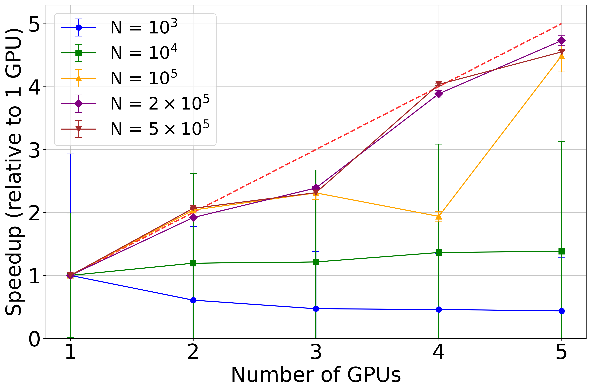

Distributed simulations
=======================

Odisseo leverages JAX’s native support for data-parallel computation to scale N-body simulations efficiently across one or more GPUs. This is particularly useful when:
 - [Running many simulations in parallel on a single device](#parallel-simulations-on-a-single-device).
 - [Running many simulations in parallel on multiple devices](#parallel-simulations-on-multiple-devices).
 - [Accelerating a single large simulation across multiple devices](#parallelizing-a-single-simulation-on-multiple-devices).
JAX encourages a "computation follows data" strategy: once your data is on a device (e.g., a GPU), JAX will execute the corresponding operations on that same device automatically.

## Selecting devices
When a GPU is available, `jax` will pre-allocate memory and natively use it. If multiple GPUs are available, memory will be pre-allocated on all of them, but the data is put only on the first `GpuDevice(id=0)`. 

### GPU
For GPU selection the `autocvd` package is suggested:

```python
from autocvd import autocvd
autocvd(num_gpus = 2)                       #automatically chooses two free GPU
```

or alternatively 

```python
import os
os.environ["CUDA_VISIBLE_DEVICES"] = "0, 1"  # Use only the first 2 GPUs
```

### CPU
For CPU it suggested to adopt the built in `jax` function as follows:

```python
import jax

jax.config.update('jax_num_cpu_devices', 2)
```

## Parallel simulations on a single device
When running on a single device, it is suggested to use the `jax.vmap` function.
A minimal example is presented below for a 7-parameters problem:

```python 
from autocvd import autocvd
autocvd(num_gpus = 1)

import time

import jax
import jax.numpy as jnp
from jax import jit, random

jax.config.update("jax_enable_x64", True)

import numpy as np
from astropy import units as u

from odisseo import construct_initial_state
from odisseo.dynamics import  DIRECT_ACC_MATRIX
from odisseo.option_classes import SimulationConfig, SimulationParams
from odisseo.option_classes import MNParams, NFWParams, PlummerParams, PSPParams
from odisseo.option_classes import  MN_POTENTIAL, NFW_POTENTIAL, PSP_POTENTIAL
from odisseo.initial_condition import Plummer_sphere
from odisseo.time_integration import time_integration
from odisseo.units import CodeUnits
from odisseo.utils import projection_on_GD1

code_length = 10.0 * u.kpc
code_mass = 1e4 * u.Msun
code_time = 3 * u.Gyr
code_units = CodeUnits(code_length, code_mass, G=1, unit_time = code_time )  


config = SimulationConfig(N_particles = 1_000,
                          return_snapshots = False, 
                          num_timesteps = 1000, 
                          external_accelerations=(NFW_POTENTIAL, MN_POTENTIAL, PSP_POTENTIAL), 
                          acceleration_scheme = DIRECT_ACC_MATRIX,
                          softening = (0.1 * u.pc).to(code_units.code_length).value,) #default values

@jit
def run_simulation(rng_key, 
                   params):
    
    #the center of mass needs to be integrated backwards in time first 
    config_com = config._replace(N_particles=1,)
    params_com = params._replace(t_end=-params.t_end,)

    #this is the final position of the cluster, we need to integrate backwards in time 
    pos_com_final = jnp.array([[11.8, 0.79, 6.4]]) * u.kpc.to(code_units.code_length)
    vel_com_final = jnp.array([[109.5,-254.5,-90.3]]) * (u.km/u.s).to(code_units.code_velocity)
    mass_com = jnp.array([params.Plummer_params.Mtot]) 
    
    #we construct the initial state of the com 
    initial_state_com = construct_initial_state(pos_com_final, vel_com_final,)
    #we run the simulation backwards in time for the center of mass
    final_state_com = time_integration(initial_state_com, mass_com, config=config_com, params=params_com)
    #we calculate the final position and velocity of the center of mass
    pos_com = final_state_com[:, 0]
    vel_com = final_state_com[:, 1]

    #we construct the initial state of the Plummer sphere
    positions, velocities, mass = Plummer_sphere(key=random.PRNGKey(rng_key), params=params, config=config)
    #we add the center of mass position and velocity to the Plummer sphere particles
    positions = positions + pos_com
    velocities = velocities + vel_com
    #initialize the initial state
    initial_state_stream = construct_initial_state(positions, velocities, )
    #run the simulation
    final_state = time_integration(initial_state_stream, mass, config=config, params=params)

    return final_state

#CONSTRUCT THE VMAP VERSION OF THE RUN_SIMULATION
@jit
def vmapped_run_simulation(rng_key, params_values):
    params_samples = SimulationParams(t_end = params_values[0],
                          Plummer_params = PlummerParams(Mtot=params_values[1],),
                          NFW_params = NFWParams(Mvir=params_values[2] ,),
                          MN_params = MNParams(M = params_values[3] ,),
                          G = code_units.G, )
    return run_simulation(rng_key, params_samples)

n_sim = 10                                                          #NUMBER OF SIMULATION TO RUN IN PARALLEL
Mvir = jnp.linspace(params.NFW_params.Mvir * 0.5, params.NFW_params.Mvir * 2, n_sim)
t_end = jnp.linspace(params.t_end * 0.5, params.t_end * 2, n_sim)
M_Plummer = jnp.linspace(params.Plummer_params.Mtot * 0.5, params.Plummer_params.Mtot * 2, n_sim)
M_MN = jnp.linspace(params.MN_params.M * 0.5, params.MN_params.M * 2, n_sim)
params_values = jnp.array([Mvir, t_end, M_Plummer, M_MN]).T         #SHAPE(N_SIM, 4)   
key = jnp.arange(n_sim)

simulations = jax.vmap(vmapped_run_simulation)(params_values,  key) #SHAPE(N_SIM, N_PARTICLES, 2, 3)
```

## Parallel simulations on multiple devices
When running multiple independent simulations in parallel the input parameters are sharded into the available devices.
A minimal example is presented below for the same 4 parameters problem as before, the set up of the simulation is equivalent:

```python
from autocvd import autocvd
autocvd(num_gpus = 2)               #RUN ON 2 GPUs

from jax.sharding import Mesh, PartitionSpec, NamedSharding         #IMPORT NEEDED FOR AUTOMATIC PARALLELISM


# IMPORT AND SET UP THE SIMULATION
n_sim = 10                                                          #NUMBER OF SIMULATION TO RUN IN PARALLEL, IT MUST BE DIVISIBLE BY THE NUMBER OF GPUs
Mvir = jnp.linspace(params.NFW_params.Mvir * 0.5, params.NFW_params.Mvir * 2, n_sim)
t_end = jnp.linspace(params.t_end * 0.5, params.t_end * 2, n_sim)
M_Plummer = jnp.linspace(params.Plummer_params.Mtot * 0.5, params.Plummer_params.Mtot * 2, n_sim)
M_MN = jnp.linspace(params.MN_params.M * 0.5, params.MN_params.M * 2, n_sim)
params_values = jnp.array([Mvir, t_end, M_Plummer, M_MN]).T         #SHAPE(N_SIM, 4)   
key = jnp.arange(n_sim)

#SHARD THE INPUT OF THE SIMULATION
mesh = Mesh(np.array(jax.devices()), ("n_sim",))                                                    #MESH OBJECT FOR JAX AUTOMATIC PARALLELISM                
params_values_sharded = jax.device_put(params_values, NamedSharding(mesh, PartitionSpec("n_sim")))  #PUT THE INPUT VALUES ON THE GPUs

#RUN THE SIMULATION AS USUAL
simulations = jax.vmap(vmapped_run_simulation)(params_values,  key) #SHAPE(N_SIM, N_PARTICLES, 2, 3)
```

## Parallelizing a single simulation on multiple devices
In the case of very large number of particles, a simulation can benefit by sharding the `initial_conditions` (positions and velocities) and `masses` across multiple GPUs to speed up the computation. The sharding can help to reduce the RAM requirement, and speed up the computational time, but for very few `N_particles` the time will be dominated by the communication time between devices. In order to achieve this the two arrays must be sharded as shown in the following example (the set up is similar to the previous example):

```python
from autocvd import autocvd
autocvd(num_gpus = 2)               #RUN ON 2 GPUs

from jax.sharding import Mesh, PartitionSpec, NamedSharding         #IMPORT NEEDED FOR AUTOMATIC PARALLELISM

#THIS TIME THE PARAMETERS STAY FIXED
params = SimulationParams(t_end = (3 * u.Gyr).to(code_units.code_time).value,  
                          Plummer_params= PlummerParams(Mtot=(10**4.05 * u.Msun).to(code_units.code_mass).value,
                                                        a=(8 * u.pc).to(code_units.code_length).value),
                           MN_params= MNParams(M = (68_193_902_782.346756 * u.Msun).to(code_units.code_mass).value,
                                              a = (3.0 * u.kpc).to(code_units.code_length).value,
                                              b = (0.280 * u.kpc).to(code_units.code_length).value),
                          NFW_params= NFWParams(Mvir=(4.3683325e11 * u.Msun).to(code_units.code_mass).value,
                                               r_s= (16.0 * u.kpc).to(code_units.code_length).value,),                      
                          G=code_units.G, ) 

config = SimulationConfig(N_particles = 1_000_000, #PARALLELIZATION IS USEFUL WHEN THE N_particles IS LARGE, 
                          return_snapshots = False, 
                          num_timesteps = 1000, 
                          external_accelerations=(NFW_POTENTIAL, MN_POTENTIAL, PSP_POTENTIAL), 
                          acceleration_scheme = DIRECT_ACC_MATRIX,
                          softening = (0.1 * u.pc).to(code_units.code_length).value,) #default values

#set up the particles in the initial state
positions, velocities, mass = Plummer_sphere(key=random.PRNGKey(4), params=params, config=config)

#initialize the initial state
initial_state = construct_initial_state(positions, velocities)
mesh = Mesh(np.array(jax.devices()), ("i",))                                            #MESH OBJECT FOR JAX AUTOMATIC PARALLELISM     
initial_state = jax.device_put(initial_state, NamedSharding(mesh, PartitionSpec("i")))  #PUT THE initial_state  ON THE GPUs
mass = jax.device_put(mass, NamedSharding(mesh, PartitionSpec("i")))                    #PUT THE mass ON THE GPUs

simulation = time_integration(initial_state, mass, config=config, params=params) #RUN DIRECTLY THE time_integration function
```

Below a benchmark of this sharding scheme. It can be appreciated that for very large `N_particles` an almost linear scaling is achieved with respect to the number of GPUs.
This benchmark was run on NVIDIA A100 with 40GB of memory.


## One large simulation across the GPUs of a node

Two FMM lanes split ONE system over the GPUs of a node: jaccpot's production runner in
its multi-GPU mode (lane `"fmm_mesh_runner"`, the one to use) and the older jaccpot mesh
lane (`"fmm_mesh"`, below). Both are `config.fmm_mesh=True`; the options object picks
between them.

### jaccpot's production runner across the cards

`fmm_mesh=True` with `fmm_preset="galaxy"` runs the single-GPU production lane's runner
(`docs/source/production_fmm.md`) on every card of a 1-D mesh: the same galaxy settings
(leaf 64, p6, Dehnen's eq (16a) MAC at 1e-4), external field, units and snapshots;
Morton domains re-balanced between segments; each segment one compiled program on the
fused multi-GPU lane; a segment that outgrows a capacity on any card re-planned and
re-run on all of them. The run is one process that sees every card it uses:

```bash
eval $(autocvd -q -l -n 2 -e -t 120)     # two least-used cards; or set CUDA_VISIBLE_DEVICES
export XLA_PYTHON_CLIENT_PREALLOCATE=false
export XLA_FLAGS="--xla_gpu_experimental_enable_fusion_autotuner=false \
--xla_gpu_unsupported_use_ragged_all_to_all_one_shot_kernel=false \
--xla_gpu_allow_ragged_all_to_all_nccl_send_recv_fallback=true \
--xla_gpu_experimental_ragged_all_to_all_use_barrier_with_nccl=false"
python run.py
```

XLA reads `XLA_FLAGS` once, when jax starts, so they go in the environment (or at the
top of the script, before `import jax`). The first flag is every production run's; the
other three are `jaccpot.distributed.fused.RAGGED_EXCHANGE_XLA_FLAGS`, XLA's NCCL
send/recv path for the cross-domain exchange (without them the exchange is several times
slower across PCIe, and on jax 0.11 it delivers nothing and the next call deadlocks);
jaccpot warns when they are missing. After an `autocvd` timeout check that
`jax.devices()` are GPUs: the timeout leaves `CUDA_VISIBLE_DEVICES` empty and the run
lands on the CPU. In `run.py`:

```python
from odisseo.mesh_runner_coupling import MeshRunnerOptions

config = config._replace(acceleration_scheme=FMM_ACC, fmm_preset="galaxy", fmm_mesh=True,
                         mesh_options=MeshRunnerOptions(ndev=2))  # None: every device
final = integrate(state, mass, config, params)   # host NumPy array, input order
```

`MeshRunnerOptions` has the mesh-only knobs: `ndev`, `repartition_every`,
`cap_headroom` and `force` (`docs/source/production_fmm.md`, "Across the GPUs of a
node", with what differs from one card: G and the softening are the solver's, the
final state is a host array, the energy is NaN until jaccpot's fused mesh force has a
potential). The mesh mode is NOT deterministic run to run on GPUs yet (two straight
runs differ at round-off in the cross-domain field; jaccpot `docs/production.md`), so
compare GPU runs with a tolerance and an A-vs-A control, never bitwise.

**Checked on two A100s** (2026-10-23, jaccpot's multi-GPU mode from its S11 session 2
branch; cards shared with other users' jobs, so the times are not results). A Plummer
sphere (G = M = a = 1, truncated at r = 10), N = 1,048,576 in float32, an NFW halo
(`Mvir=10, r_s=5`), softening 1e-3 (`ferrers3`), dt 5e-3, 16 steps, the galaxy preset:

| | |
|---|---|
| `integrate()` with 4 snapshots | lane `"fmm_mesh_runner"`; snapshots at steps 0, 4, 8, 12, the first one the initial state bit for bit; `total_energy` NaN (`energy_unavailable`: the fused mesh force has no potential yet); `|L - L0| / |L0|` at most 1.4e-6 (one card: 5.6e-6) |
| flags | each fresh run's first segment retried once (cross-domain capacities grown), the kept run's flags clean; the same with jaccpot's runner called directly on these particles |
| final state against the single-card `"fmm_runner"` lane | 4,751,613 of 6,291,456 elements differ; positions max 1.9e-6 (rel-L2 6.6e-8); velocity difference / velocity change 9.0e-5 |
| control: the mesh lane twice (A-vs-A) | 171,131 of 6,291,456 differ; positions max 2.4e-7; velocity difference / change 1.8e-7 (one card twice: 0 differ) |
| self-gravity rel-L2 against an fp64 direct sum (512 particles, final state) | mesh 1.800e-4, one card 1.749e-4 |
| the older `"fmm_mesh"` lane (`MeshOptions` defaults: leaf 512, theta 0.7, p6, the geometric MAC) | velocity difference / change 4.3e-4 against both the single card and the mesh runner |
| a second call (other arrays, same configuration) | the kept solver and runner, no new segment program; the per-device prepares and the decomposition compile 46 small programs per fresh run |

### The older jaccpot mesh lane

`fmm_mesh=True` with a `MeshOptions` as `config.mesh_options` -- or a direct call of
`odisseo.mesh_coupling.integrate_mesh_jaccpot` (options in `MeshOptions`) -- runs a single
N-body system over all GPUs of one node with jaccpot's distributed FMM: the particles are
split into spatial domains (RCB), each device builds its own tree and imports a *halo* of
boundary particles from its neighbours, and a KDK leapfrog steps the whole system: drift,
the force (one `shard_map` program) and kick, three dispatches per step, with no potential
(so no total energy) and its own leaf size, order, opening angle and `dt` in `MeshOptions`.
It is unchanged and stays reachable while its users need it. It has carried 25 million
particles on 8×A100 (see
`benchmark_a100/bulge_rollout/` for the exact setup and record). Like every jaccpot
lane it needs `jax.config.update("jax_enable_x64", True)` at the top of the script;
the lane's own arrays stay float32 unless you ask for float64.

**Requirement: jax >= 0.9.1, verified as >= 0.10.2, in a venv without
`--system-site-packages`.** On older JAX the collective that moves the halo
(`jax.lax.ragged_all_to_all`) silently returns its fill value once its buffers move, and
the donating leapfrog moves them every step: the cross-domain near field disappears —
about a 45 % force error — while angular momentum, energy, centre of mass and every
overflow flag look healthy. Every mesh-lane run before 2026-09-04 had this. Check the
plugin that actually loaded, not `pip list`:

```python
import jax_plugins.xla_cuda12 as p; print(p.__file__)   # must be inside your venv
```

If the JAX cannot be changed, `MeshOptions(halo_exchange="buf")` (or
`tools/mesh_galaxy_run.py --halo-exchange buf`) selects the all_gather exchange: identical
forces, no measurable cost at 4 devices. And keep a moving-position probe on
(`--probe-every N`: an fp64 direct sum for a few hundred random particles): it is the only
instrument that sees this class of defect, because a run-it-twice reproducibility check
reuses the same buffers and passes. Details: `benchmark_a100/bulge_rollout/findings.md`,
section 14.
